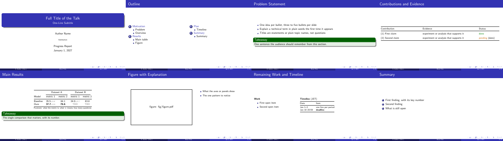
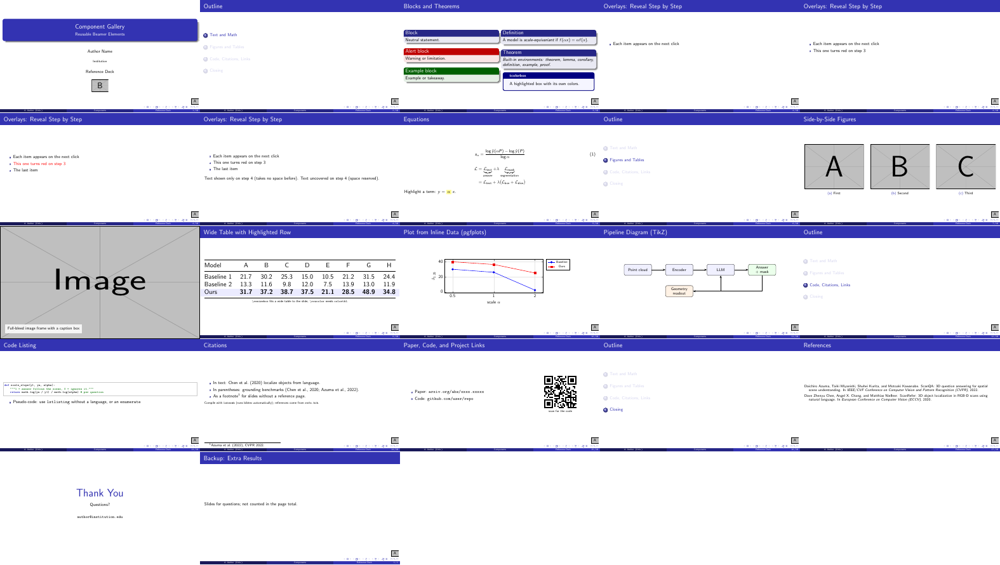

# beamer-presentation-template

An [Agent Skill](https://docs.claude.com/en/docs/agents-and-tools/agent-skills/overview) for **classic academic LaTeX Beamer slides** — the Madrid look with a navigation bar, a clean title page, and a footer — for Claude Code, Codex, and other agents that read `SKILL.md`.

It is deliberately lightweight: built-in Beamer themes only, plain `pdflatex`, no font installation, nothing downloaded at build time.



## What is included

| Path | Content |
| --- | --- |
| `SKILL.md` | Instructions for the agent (written in Chinese; the slides it produces are in English unless asked otherwise) |
| `assets/template/presentation.tex` | Starting deck: Madrid + default colors, helper macros (`\tbd`, `\sd`, `takeaway`, left-aligned `L{}` columns), a two-column outline, and example slides |
| `assets/template/components.tex` | Component gallery: blocks and theorems, overlays, equations, subfigures, full-bleed image, wide table with a highlighted row, pgfplots chart, TikZ pipeline, code listing, citations (`refs.bib`), links with a QR code, speaker notes, references, thank-you slide, backup slides that do not count toward the page total |
| `assets/template/.latexmkrc` | `latexmk` setup: auxiliary files in `build/`, PDF copied back next to the source |
| `scripts/contact_sheet.py` | Renders every page into one thumbnail sheet and lists `Overfull` warnings |
| `scripts/pdf2pptx.py` | Exports `.pptx` from the final PDF (one full-slide image per page, identical to the PDF); `--key` converts to Keynote on macOS |
| `scripts/mcp_server.py` | Optional MCP server exposing the same workflow as tools |



## Install

```bash
# Claude Code (user-level skill)
git clone https://github.com/Moviw/beamer-presentation-template ~/.claude/skills/beamer-presentation-template

# Codex, or a shared location linked into both
git clone https://github.com/Moviw/beamer-presentation-template ~/.agents/skills/beamer-presentation-template
ln -s ~/.agents/skills/beamer-presentation-template ~/.claude/skills/
ln -s ~/.agents/skills/beamer-presentation-template ~/.codex/skills/
```

Then ask the agent for slides, e.g. *"make a 12-slide progress report on these results"*.

**Requirements:** TeX Live with `latexmk` (the gallery also uses `tikz`, `pgfplots`, `listings`, `tcolorbox`, `qrcode`, `natbib`, `appendixnumberbeamer`, `mwe`), poppler (`pdftoppm`), Python 3 with Pillow. Export needs `pip install python-pptx`; `.key` export needs Keynote on macOS.

## Use without an agent

```bash
cp -r assets/template my-talk && cd my-talk
latexmk                                 # build presentation.pdf
latexmk -pvc -interaction=nonstopmode   # rebuild on every save
latexmk components.tex                  # build the component gallery
python3 ../scripts/contact_sheet.py presentation.pdf   # check all pages at once
python3 ../scripts/pdf2pptx.py presentation.pdf        # → presentation.pptx (add --key on macOS)
```

Do not run a manual build in a directory where `latexmk -pvc` is already running: two processes writing the same PDF corrupt it.

## MCP server (optional)

```bash
claude mcp add beamer -- uv run --script /path/to/beamer-presentation-template/scripts/mcp_server.py
```

Dependencies (`mcp<2`, `python-pptx`, `pillow`) are declared inline and installed by `uv`. Tools:

| Tool | Purpose |
| --- | --- |
| `new_deck(dest)` | Copy the template into a new directory |
| `compile_deck(directory, tex)` | Build with `latexmk`; returns page count, errors, and overfull boxes |
| `contact_sheet(pdf)` | Thumbnail sheet of all pages, returned as an image |
| `render_page(pdf, page)` | One page at higher resolution, returned as an image |
| `export_pptx(pdf, keynote)` | Export `.pptx`; on macOS optionally `.key` |

## Design notes

- **Built-in themes only.** Third-party "classic" templates change under the same URL; Beamer's own `Madrid`, `Berlin`, `Warsaw`, or `Copenhagen` never do.
- **PDF is the source of truth.** PowerPoint and Keynote files are image-per-slide copies of the PDF, so all three look the same; their text is not editable.
- **Layout rules in `SKILL.md`** come from real talks: statement-style titles, takeaways only on key slides, booktabs tables with left-aligned text columns, time zones on timelines, and a consistency pass after numbers change.

## License

MIT — see [LICENSE](LICENSE).
